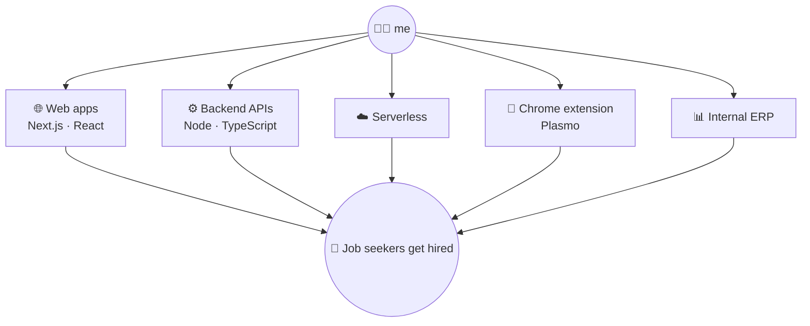

<p align="center">
  <a href="https://devanshlodhi.pro"></a>
</p>

<h3 align="center">👋 Pick your path. This README changes depending on who you are.</h3>

<details>
<summary><b>💼 &nbsp;I'm a recruiter / founder: give me the 10-second version</b></summary>
<br/>

> **Devansh Lodhi** · SDE at **[NxtJob.ai](https://nxtjob.ai)** · India
>
> I work across every NxtJob repo: the web apps, the backend APIs, serverless, the Chrome extension and the internal ERP. If it ships at NxtJob, I've probably had my hands in it.
>
> **Strongest at:** Next.js · React · TypeScript · Node · end-to-end product work
> **Portfolio:** [devanshlodhi.pro](https://devanshlodhi.pro) &nbsp;·&nbsp; **Email:** [devansh@nxtjob.ai](mailto:devansh@nxtjob.ai)

</details>

<details>
<summary><b>🧑‍💻 &nbsp;I'm a developer: show me the code-brain</b></summary>
<br/>

```bash
$ npx devansh --help

Usage: devansh [command]

Commands:
  build <idea>        turns a Figma frame into a Next.js page that feels alive
  autofill <portal>   teaches a Chrome extension to fill Workday, Greenhouse, SuccessFactors…
  animate <anything>  adds Framer Motion until it's smooth, then removes 30% of it
  debug <bug>         console.log("here") → console.log("here 2") → fixed
  coffee              required dependency, no known alternative

Options:
  --scope     every nxtjob repo, frontend to backend
  --stack     next, react, typescript, tailwind, redux, zustand, plasmo, node, express
  --vibe      dark mode only
  --version   always learning, never 1.0
```

</details>

<details>
<summary><b>🍿 &nbsp;I'm just scrolling: entertain me</b></summary>
<br/>

```diff
  git log --oneline ~/life

+ a1b2c3d  feat: wrote first <marquee>, felt like a hacker
+ d4e5f6a  feat: discovered React, never looked back
+ 7890abc  fix: center a div (attempt #47, success)
+ bcd1234  feat: joined NxtJob.ai to fix job hunting
+ ef56789  feat: promoted to SDE, got write access to every repo 🔑
+ 0a1b2c3  refactor: stopped saying "that's not my repo"
- 4d5e6f7  revert: "sleep schedule"
+ HEAD     wip: web, api, serverless, extension, erp… all at once
```

</details>

<br/>

## 🎒 Inventory

<table>
<tr>
<td width="50%" valign="top">

**⚔️ Main weapons**
<br/><br/>


**🛡️ Armor**
<br/><br/>


</td>
<td width="50%" valign="top">

**🧪 Potions**
<br/><br/>


**🗺️ Tools of the trade**
<br/><br/>


</td>
</tr>
</table>

## 🗺️ My territory at NxtJob: all of it



## 🏆 Achievements unlocked

<p align="center">
  
  
  
  
  
</p>

## 📊 Character sheet

<p align="center">
  
  
</p>
<p align="center">
  
</p>

## 📡 Open a connection

```bash
$ ping devansh
```

<p>
  <a href="https://devanshlodhi.pro"></a>
  <a href="mailto:devansh@nxtjob.ai"></a>
</p>

<p align="center"><sub>Thanks for scrolling this far. You found the secret: <code>exit 0</code> 🫡</sub></p>
